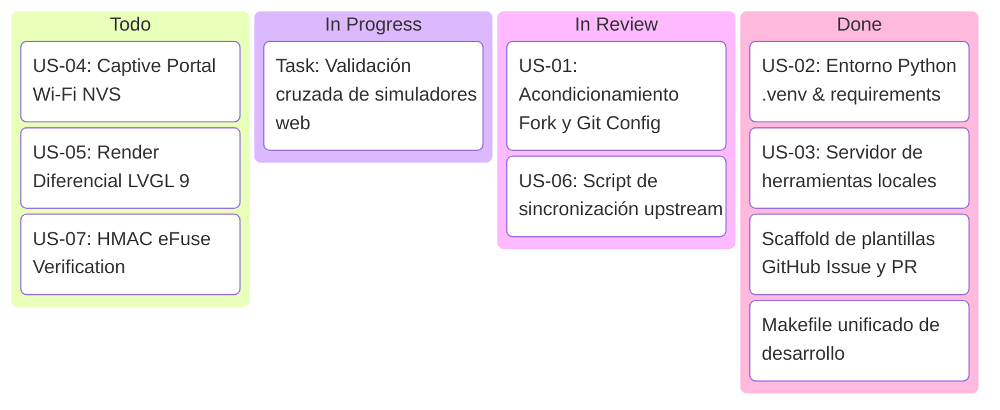

# 🏃 Sprint 1: Acondicionamiento del Ecosistema DigiVice y Sincronización Fork

> **Objetivo del Sprint:** Configurar la infraestructura ágil del repositorio fork (`gruizmetasolutions-cpu/Digidata`), enlazar el remote upstream (`DEV-Dataholics/DigiVice`), aislar el entorno de ejecución Python para observabilidad y proveer scripts de automatización para desarrollo y pruebas.

---

## 📊 Métricas del Sprint

| Métrica | Valor |
| :--- | :--- |
| **Estado:** | 🟢 **Activo** |
| **Capacidad Estimada:** | 10 Story Points |
| **Story Points Completados:** | 8 Story Points |
| **Historias Incluidas:** | `US-01`, `US-02`, `US-03`, `US-06` |
| **Ramas Involucradas:** | `main`, `feat/scaffold-desarrollo-agil` |

---

## 📌 Tablero Ágil (Sprint Board)

---

## 📝 Tareas del Sprint

### 1. Infraestructura de Git & Fork
- [x] Conectar y verificar remote `upstream` hacia `https://github.com/DEV-Dataholics/DigiVice.git`.
- [x] Comprobar paridad de ramas entre `origin/main` y `upstream/main`.
- [x] Crear script de sincronización desatendida `scripts/sync_upstream.sh`.
- [x] Redactar guía de trabajo en Git para forks en `docs/agile/GIT_WORKFLOW.md`.

### 2. Entorno de Desarrollo Local
- [x] Crear `server/requirements.txt` con dependencias del daemon (`fastapi`, `uvicorn`, `psutil`).
- [x] Ignorar `.venv/` en `.gitignore`.
- [x] Crear y verificar entorno virtual `.venv` con paquetes instalados.
- [x] Crear script de lanzamiento del servidor `scripts/run_server.sh`.
- [x] Crear script de previsualización de simuladores web `scripts/serve_tools.sh`.
- [x] Crear `Makefile` con comandos rápidos (`make setup`, `make sync`, `make server`, `make tools`).

### 3. Gobernanza Ágil y Plantillas
- [x] Crear Product Backlog general en `BACKLOG.md`.
- [x] Crear Sprint Board en `SPRINT.md`.
- [x] Crear plantillas de GitHub en `.github/ISSUE_TEMPLATE/` (User Story, Bug, Task).
- [x] Crear plantilla de Pull Request en `.github/PULL_REQUEST_TEMPLATE.md`.
- [x] Documentar ceremonias ágiles en `docs/agile/CEREMONIES.md`.

---

## 🗓️ Registro Diario / Standup Log

* **Día 1:**
  - **¿Qué se hizo?** Se analizó la estructura del repositorio DigiVice. Se enlazó el upstream de Dataholics y se verificó que no hubiese divergencia. Se configuró el entorno Python con `uv`, se creó el `Makefile`, scripts de automatización y plantillas ágiles.
  - **¿Qué se hará hoy?** Validar el flujo de ejecución local del daemon de telemetría y levantar los simuladores web para pruebas de la suite Scrap-Hound y Gundam HUD.
  - **¿Hay impedimentos?** Ninguno. El entorno se encuentra completamente operativo.
